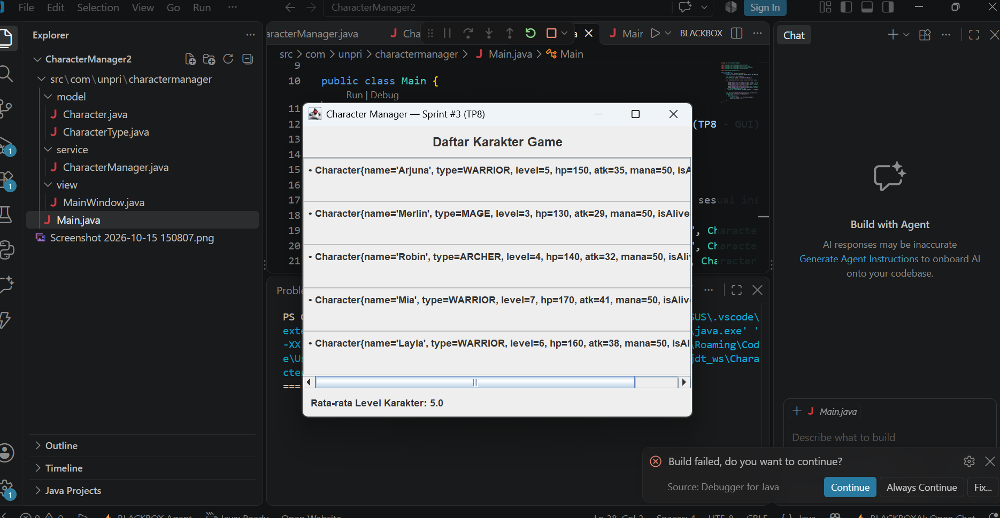
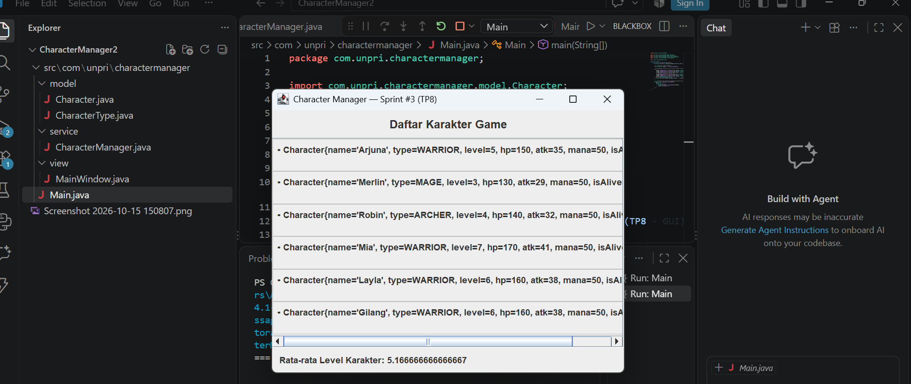
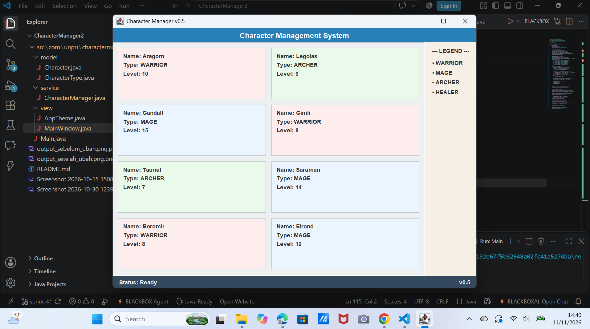
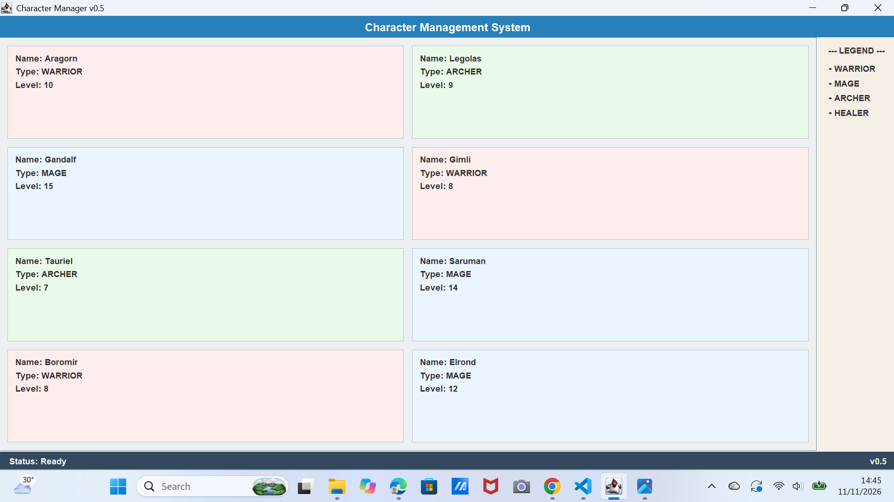
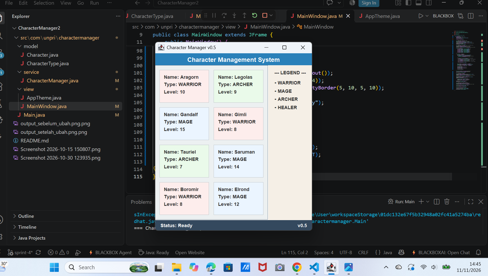

# Character Manager — Sprint #3 (TP8)

## 📌 Deskripsi Proyek
Sprint #3 (TP8) ini merupakan transisi besar dari aplikasi berbasis console (TP1-TP5) menuju aplikasi berbasis **GUI (Graphical User Interface)** menggunakan **Java Swing** serta menerapkan standar arsitektur **MVC (Model-View-Controller)**.

## 🖼️ Screenshot Aplikasi (`MainWindow`)
* **Kondisi Awal (5 Karakter):**
  
* **Kondisi Setelah Perubahan (6 Karakter & Statistik Berubah):**
  

## 🔄 Alur Aliran Data (MVC)
Aliran data dalam aplikasi ini berjalan secara terstruktur: 
1. `Main.java` menginisialisasi **Model** (`Character`) dan **Service/Controller** (`CharacterManager`).
2. `CharacterManager` mengelola kumpulan data karakter di dalam *ArrayList* dengan enkapsulasi yang aman.
3. `MainWindow` (**View**) meminta data dari `CharacterManager` melalui *looping* dinamis dan menampilkan antarmuka grafis ke pengguna secara aman di dalam *Event Dispatch Thread* (`SwingUtilities.invokeLater`).

## 📋 Daftar Karakter
1. **Arjuna** — Type: `WARRIOR`, Level: 5
2. **Merlin** — Type: `MAGE`, Level: 3
3. **Robin** — Type: `ARCHER`, Level: 4
4. **Mia** — Type: `WARRIOR`, Level: 7
5. **Layla** — Type: `WARIOR`, Level: 6
6. **Gilang** — Type: `WARRIOR`, Level: 10

## 🔗 Tautan Analisis Desain (Google Docs)
Analisis mendalam mengenai GUI, *Event-Driven*, dan prinsip arsitektur MVC dapat diakses melalui tautan berikut:
[Google Docs - Analisis GUI & MVC TP8](https://1drv.ms/w/c/52209F330F5FBB7F/IQAj8-oh6DTwR4X3mpnfSrVEAVCZ3ClgBM29_oFPE4m-fgw?e=MO115h)

## TP12 — Implementasi Layout, JScrollPane, dan Analisis MVC

### 1. Wireframe / Sketsa Tata Letak
*(Lampirkan sketsa gambar tangan atau diagram struktur layout antarmuka aplikasi di sini)*
<!-- Contoh:  -->

### 2. Tangkapan Layar (Screenshots)
Berikut adalah tiga kondisi tangkapan layar antarmuka aplikasi saat dijalankan:
* **Ukuran Awal (Default):**  
  
* **Jendela Dilebarkan (Maximize):**  
  
* **Jendela Dikecilkan (Scrollbar Tampak):**  
 

### 3. Tabel Pengamatan Resize (Prediksi vs Hasil)
| Kondisi Jendela | Prediksi Perilaku Layout | Hasil Pengamatan Nyata |
| :--- | :--- | :--- |
| **Dilebarkan (Maximize)** | Header di `NORTH` dan status bar di `SOUTH` merentang secara horizontal. Panel kartu di `CENTER` dan legenda di `EAST` menyesuaikan ruang area kosong secara proporsional. | Sesuai prediksi, komponen merentang dengan rapi tanpa merusak tata letak elemen di dalamnya. |
| **Dikecilkan (Minimize)** | Area tengah menyusut mengikuti batas minimal jendela, dan komponen `JScrollPane` otomatis mengaktifkan *scrollbar* vertikal untuk menjaga aksesibilitas kartu karakter. | Sesuai prediksi, *scrollbar* vertikal aktif dan seluruh kartu tetap dapat diakses dengan menggulir layar. |

### 4. Penjelasan Struktur Panel Bersarang & Alasan Layout
Aplikasi ini menerapkan struktur panel bersarang (*nested panels*) di mana kerangka utama jendela menggunakan `BorderLayout` untuk membagi wilayah fungsional secara tegas ke dalam empat sisi (Header, Daftar Kartu, Legenda, dan Bar Status). Bagian daftar karakter dibungkus ke dalam `JScrollPane` yang menampung kontainer berbasis `GridLayout` agar kartu-kartu data tersusun simetris dan rapi. Layout `BoxLayout` dipilih khusus untuk panel legenda di sebelah timur (`EAST`) karena memberikan kontrol vertikal yang presisi melalui penggunaan *strut* dan *glue*. Sebaliknya, penggunaan layout absolut (`setLayout(null)`) ditolak karena kaku, tidak responsif, dan menyebabkan komponen terpotong saat ukuran jendela diubah.

### 5. Tautan Analisis (Bagian D)
* **Google Docs Analisis Layout & MVC:** [Buka Dokumen Analisis] 
https://1drv.ms/w/c/52209F330F5FBB7F/IQCsn_Bi_7o1QJEECKCyBFylAepQo7MT_p84d3k3uAuKavk?e=0bmK7R