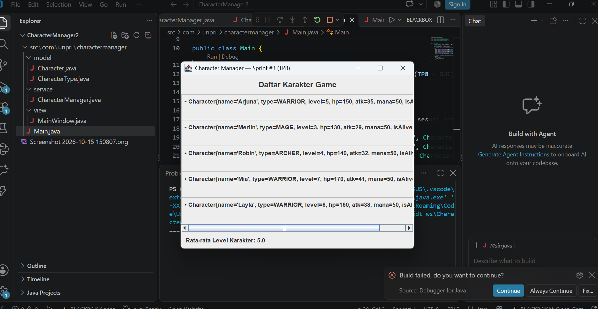
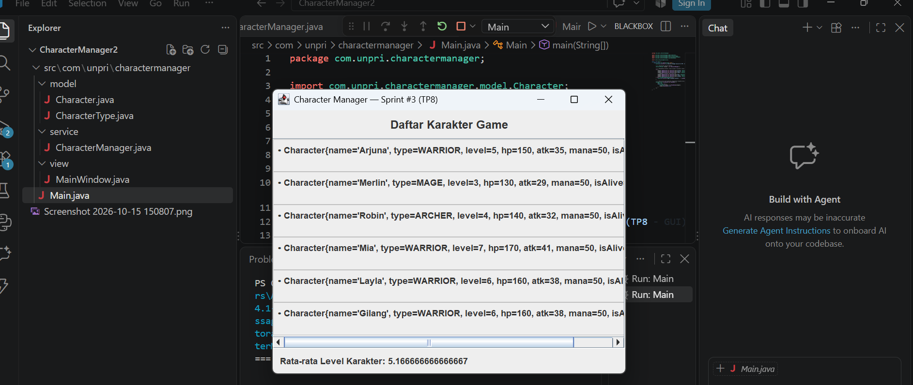
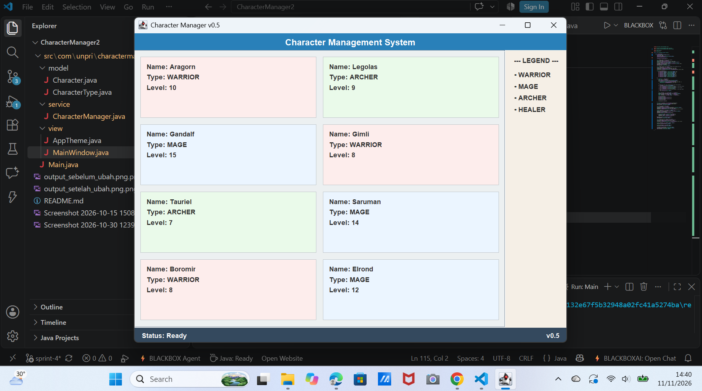
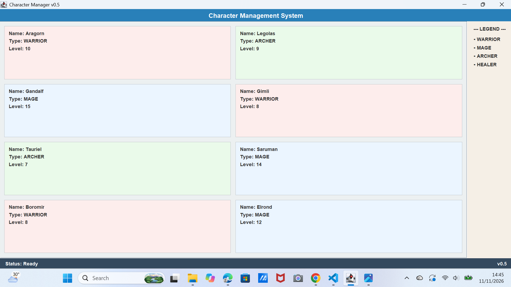
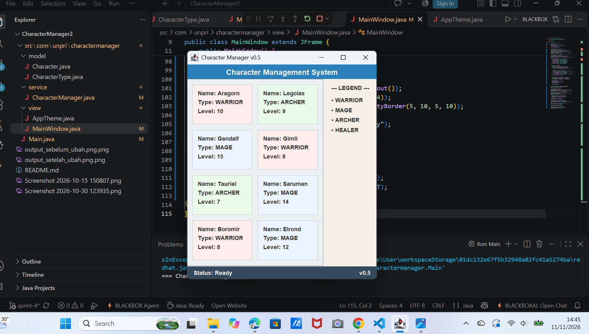
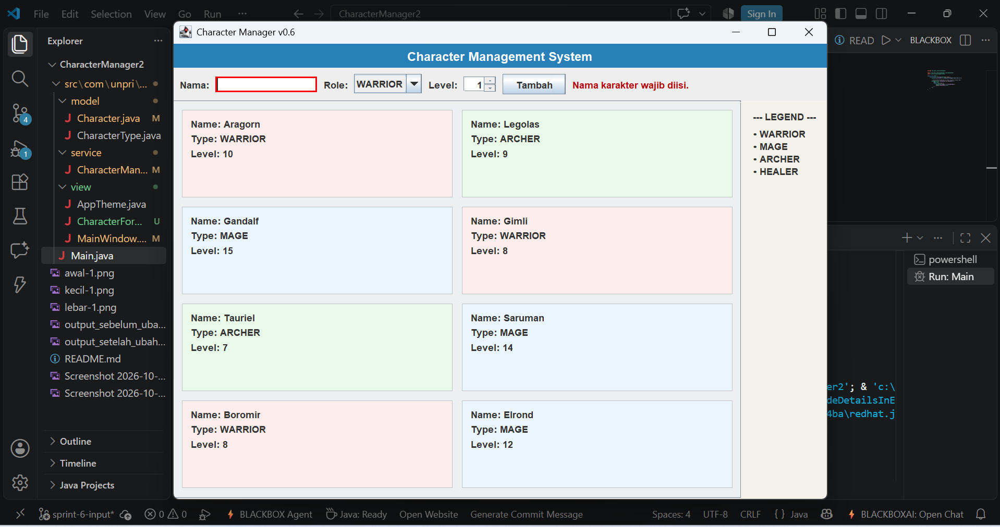
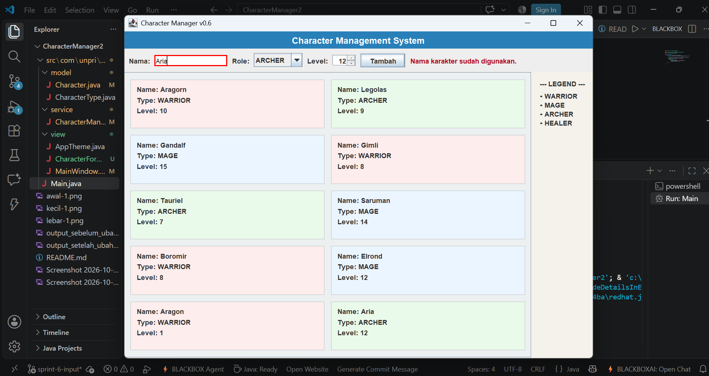
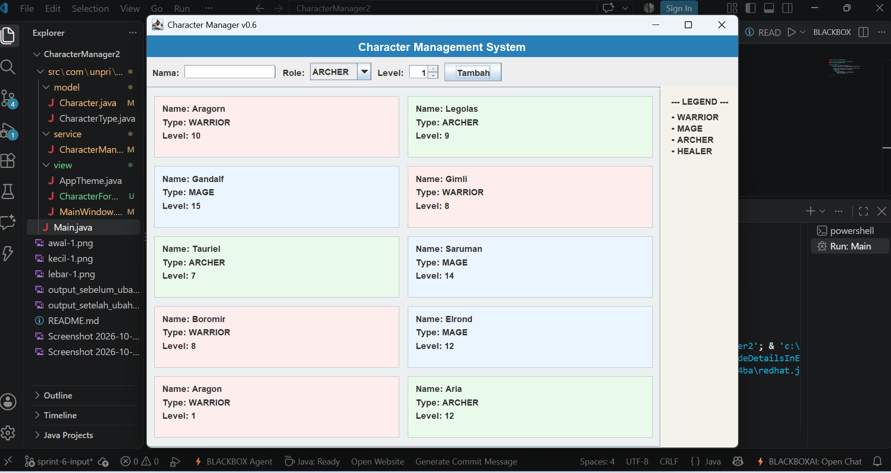

# Character Manager — Sprint #3 (TP8)

## 📌 Deskripsi Proyek
Sprint #3 (TP8) ini merupakan transisi besar dari aplikasi berbasis console (TP1-TP5) menuju aplikasi berbasis **GUI (Graphical User Interface)** menggunakan **Java Swing** serta menerapkan standar arsitektur **MVC (Model-View-Controller)**.

## 🖼️ Screenshot Aplikasi (`MainWindow`)
* **Kondisi Awal (5 Karakter):**
  
* **Kondisi Setelah Perubahan (6 Karakter & Statistik Berubah):**
  

## 🔄 Alur Aliran Data (MVC)
Aliran data dalam aplikasi ini berjalan secara terstruktur: 
1. `Main.java` menginisialisasi **Model** (`Character`) dan **Service/Controller** (`CharacterManager`).
2. `CharacterManager` mengelola kumpulan data karakter di dalam *ArrayList* dengan enkapsulasi yang aman.
3. `MainWindow` (**View**) meminta data dari `CharacterManager` melalui *looping* dinamis dan menampilkan antarmuka grafis ke pengguna secara aman di dalam *Event Dispatch Thread* (`SwingUtilities.invokeLater`).

## 📋 Daftar Karakter
1. **Arjuna** — Type: `WARRIOR`, Level: 5
2. **Merlin** — Type: `MAGE`, Level: 3
3. **Robin** — Type: `ARCHER`, Level: 4
4. **Mia** — Type: `WARRIOR`, Level: 7
5. **Layla** — Type: `WARIOR`, Level: 6
6. **Gilang** — Type: `WARRIOR`, Level: 10

## 🔗 Tautan Analisis Desain (Google Docs)
Analisis mendalam mengenai GUI, *Event-Driven*, dan prinsip arsitektur MVC dapat diakses melalui tautan berikut:
[Google Docs - Analisis GUI & MVC TP8](https://1drv.ms/w/c/52209F330F5FBB7F/IQAj8-oh6DTwR4X3mpnfSrVEAVCZ3ClgBM29_oFPE4m-fgw?e=MO115h)

## TP12 — Implementasi Layout, JScrollPane, dan Analisis MVC

### 1. Wireframe / Sketsa Tata Letak
*(Lampirkan sketsa gambar tangan atau diagram struktur layout antarmuka aplikasi di sini)*
<!-- Contoh:  -->

### 2. Tangkapan Layar (Screenshots)
Berikut adalah tiga kondisi tangkapan layar antarmuka aplikasi saat dijalankan:
* **Ukuran Awal (Default):**  
  
* **Jendela Dilebarkan (Maximize):**  
  
* **Jendela Dikecilkan (Scrollbar Tampak):**  
 

### 3. Tabel Pengamatan Resize (Prediksi vs Hasil)
| Kondisi Jendela | Prediksi Perilaku Layout | Hasil Pengamatan Nyata |
| :--- | :--- | :--- |
| **Dilebarkan (Maximize)** | Header di `NORTH` dan status bar di `SOUTH` merentang secara horizontal. Panel kartu di `CENTER` dan legenda di `EAST` menyesuaikan ruang area kosong secara proporsional. | Sesuai prediksi, komponen merentang dengan rapi tanpa merusak tata letak elemen di dalamnya. |
| **Dikecilkan (Minimize)** | Area tengah menyusut mengikuti batas minimal jendela, dan komponen `JScrollPane` otomatis mengaktifkan *scrollbar* vertikal untuk menjaga aksesibilitas kartu karakter. | Sesuai prediksi, *scrollbar* vertikal aktif dan seluruh kartu tetap dapat diakses dengan menggulir layar. |

### 4. Penjelasan Struktur Panel Bersarang & Alasan Layout
Aplikasi ini menerapkan struktur panel bersarang (*nested panels*) di mana kerangka utama jendela menggunakan `BorderLayout` untuk membagi wilayah fungsional secara tegas ke dalam empat sisi (Header, Daftar Kartu, Legenda, dan Bar Status). Bagian daftar karakter dibungkus ke dalam `JScrollPane` yang menampung kontainer berbasis `GridLayout` agar kartu-kartu data tersusun simetris dan rapi. Layout `BoxLayout` dipilih khusus untuk panel legenda di sebelah timur (`EAST`) karena memberikan kontrol vertikal yang presisi melalui penggunaan *strut* dan *glue*. Sebaliknya, penggunaan layout absolut (`setLayout(null)`) ditolak karena kaku, tidak responsif, dan menyebabkan komponen terpotong saat ukuran jendela diubah.

### 5. Tautan Analisis (Bagian D)
* **Google Docs Analisis Layout & MVC:** [Buka Dokumen Analisis] 
https://1drv.ms/w/c/52209F330F5FBB7F/IQCsn_Bi_7o1QJEECKCyBFylAepQo7MT_p84d3k3uAuKavk?e=0bmK7R

# Character Manager

Aplikasi desktop Java Swing berbasis arsitektur berlapis (`model`, `service`, `view`) untuk mengelola daftar karakter beserta *role* (`WARRIOR`, `MAGE`, `ARCHER`, `HEALER`) dan levelnya.

---

## TP14

### Screenshot Pengujian

### Screenshot Pengujian

1. **Error Nama Kosong:**
   ![Error Nama Kosong] 

2. **Error Nama Duplikat:**
   ![Error Nama Duplikat] 

3. **Sukses Tambah Kartu Baru:**
   ![Sukses Tambah Kartu Baru] 

*(Catatan: Sesuaikan nama file gambar pada tautan di atas dengan nama file aktual yang kamu simpan di folder proyek, misalnya `tp14-kosong.png`, `tp14-duplikat.png`, dan `tp14-sukses.png`.)*

### Tabel Uji (8 Kasus)

| Input | Hasil Diharapkan | Hasil Nyata | Lapisan yang Menangkap |
| :--- | :--- | :--- | :--- |
| Nama kosong `""`, Role `WARRIOR`, Level `1` | Ditolak dengan pesan nama wajib diisi serta border merah pada field nama | Ditolak dengan pesan *"Nama karakter wajib diisi."* dan border merah pada field nama | View (`validateName` / `handleSubmit`) |
| Nama hanya spasi `"   "`, Role `WARRIOR`, Level `1` | Ditolak setelah `trim()` karena kosong | Ditolak dengan pesan *"Nama karakter wajib diisi."* dan border merah | View (`trim()` + `validateName`) |
| Nama diawali spasi ganda `"  Aragorn"`, Role `WARRIOR`, Level `1` | Ditolak karena diawali spasi ganda sebelum di-`trim()` | Ditolak dengan pesan larangan awalan spasi ganda | View (`handleSubmit` sebelum `trim()`) |
| Nama > 20 karakter `"KarakterSangatPanjangSekali"`, Role `ARCHER`, Level `5` | Ditolak karena melebihi batas maksimal 20 karakter | Ditolak dengan pesan *"Nama karakter maksimal 20 karakter."* | View (`validateName`) |
| Karakter simbol tidak diizinkan `"Hero@123"`, Role `WARRIOR`, Level `5` | Ditolak karena mengandung karakter di luar aturan nama | Ditolak dengan pesan validasi format nama | View (`validateName`) |
| Nama duplikat `"Aragorn"` / `"Aria"`, Role `ARCHER`, Level `12` | Ditolak karena nama karakter sudah digunakan | Ditolak dengan pesan *"Nama karakter sudah digunakan."* dan border merah | View (`validateName` -> `isNameTaken`) & Service/Model |
| Nama `"Merlin"`, Role `MAGE`, Level `65` | Ditolak karena level `MAGE` melebihi batas maksimal 60 | Ditolak dengan pesan batas maksimal level `MAGE` (60) | Model (`Character`) -> ditangkap `IllegalArgumentException` di View |
| Nama `"Aria"`, Role `ARCHER`, Level `12` | Diterima, kartu baru muncul di daftar, dan form kembali bersih | Kartu `Aria` (`ARCHER`, Level `12`) tampil di daftar dan form ter-reset | View + Model (`Character`) + Service (`CharacterManager`) |

**Catatan Perbedaan & Perbaikan:** Selama pengujian, aturan validasi teks yang sensitif terhadap spasi di awal diperiksa sebelum operasi `trim()` agar spasi ganda di awal input tidak hilang lebih dulu, sementara aturan batas level `MAGE` maksimal 60 dilemparkan melalui `IllegalArgumentException` dari lapisan Model (`Character`) agar tetap konsisten meskipun data tidak melewati form.

### Kompromi Sementara

Pada implementasi TP14, `CharacterFormPanel` menggunakan `ActionListener` minimal serta memanggil `CharacterManager` secara langsung dari lapisan View agar alur validasi dan pembaruan tampilan kartu dapat diuji dengan cepat dan jelas. Pendekatan ini diambil sebagai kompromi sementara pada tahap pengembangan ini untuk menjaga fokus pada validasi input dan integrasi dasar UI. Pada iterasi berikutnya, koordinasi aksi dan pembaruan data akan dirapikan agar pemisahan tanggung jawab antar-lapisan lebih longgar.

### Analisis Bagian D (Google Docs)

Dokumen Analisis TP14: https://1drv.ms/w/c/52209F330F5FBB7F/IQCH-X-ocFveRrGFYgAtuP2sAfRhJG59b8LH4ZLMfJsruNI?e=meUEIL