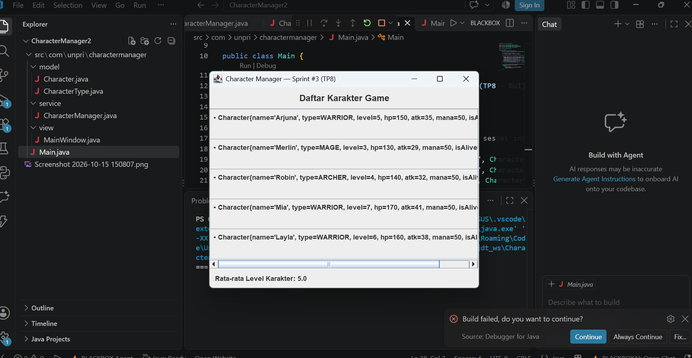
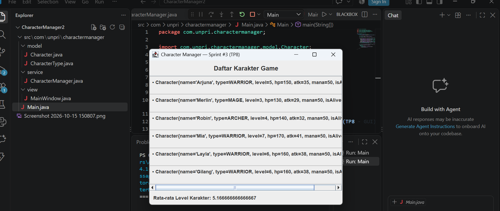

# Character Manager — Sprint #3 (TP8)

## 📌 Deskripsi Proyek
Sprint #3 (TP8) ini merupakan transisi besar dari aplikasi berbasis console (TP1-TP5) menuju aplikasi berbasis **GUI (Graphical User Interface)** menggunakan **Java Swing** serta menerapkan standar arsitektur **MVC (Model-View-Controller)**.

## 🖼️ Screenshot Aplikasi (`MainWindow`)
* **Kondisi Awal (5 Karakter):**
  
* **Kondisi Setelah Perubahan (6 Karakter & Statistik Berubah):**
  

## 🔄 Alur Aliran Data (MVC)
Aliran data dalam aplikasi ini berjalan secara terstruktur: 
1. `Main.java` menginisialisasi **Model** (`Character`) dan **Service/Controller** (`CharacterManager`).
2. `CharacterManager` mengelola kumpulan data karakter di dalam *ArrayList* dengan enkapsulasi yang aman.
3. `MainWindow` (**View**) meminta data dari `CharacterManager` melalui *looping* dinamis dan menampilkan antarmuka grafis ke pengguna secara aman di dalam *Event Dispatch Thread* (`SwingUtilities.invokeLater`).

## 📋 Daftar Karakter
1. **Arjuna** — Type: `WARRIOR`, Level: 5
2. **Merlin** — Type: `MAGE`, Level: 3
3. **Robin** — Type: `ARCHER`, Level: 4
4. **Mia** — Type: `WARRIOR`, Level: 7
5. **Layla** — Type: `WARIOR`, Level: 6
6. **Gilang** — Type: `WARRIOR`, Level: 10

## 🔗 Tautan Analisis Desain (Google Docs)
Analisis mendalam mengenai GUI, *Event-Driven*, dan prinsip arsitektur MVC dapat diakses melalui tautan berikut:
[Google Docs - Analisis GUI & MVC TP8](https://1drv.ms/w/c/52209F330F5FBB7F/IQAj8-oh6DTwR4X3mpnfSrVEAVCZ3ClgBM29_oFPE4m-fgw?e=MO115h)

# Character Manager — Sprint #4 (TP10)

## Identitas
* **Nama:** [Nama Anda]
* **NIM:** 253303621210
* **Kelas:** [Kelas Anda]
* **Mata Kuliah:** Java Visual / Pemrograman Berorientasi Objek

---

## Deskripsi Tugas (Sprint #4)
Sprint #4 berfokus pada penerapan konsep *Theming*, pengelolaan properti komponen GUI Swing, pemisahan tanggung jawab visual melalui kelas `AppTheme.java`, serta penambahan *Mini-Challenge* (karakter dengan level $\ge 5$ ditampilkan dengan teks berwarna emas dan tebal).

---

## Struktur File & Perubahan (v0.4)
1. **`AppTheme.java`** (dalam package `com.unpri.charactermanager.view`):
   * Berisi definisi konstanta warna tema utama, warna latar belakang berdasarkan *role* karakter (*Warrior*, *Mage*, *Assassin*), *font* standar aplikasi, serta *border*.
2. **`MainWindow.java`**:
   * Diperbarui untuk mengimplementasikan elemen-elemen dari `AppTheme`.
   * Menerapkan warna latar kartu secara dinamis berdasarkan *role* menggunakan `setOpaque(true)`.
   * Menambahkan logika *Mini-Challenge* untuk membedakan gaya visual karakter dengan level $\ge 5$.

---

## Dokumentasi Tangkapan Layar (Screenshot)

### Sesudah Penerapan Tema & Mini-Challenge (Sprint #4 / TP10)

---

## Link Google Docs Analisis (Bagian D)
[* Tautan Analisis Konseptual MVC: \[Masukkan Link Google Docs Anda di sini\]\](https://1drv.ms/w/c/52209F330F5FBB7F/IQCDODl3In3hR6QyofxZaF5FAam6fO9d9rVRn95dsL7kLto?e=585g7U)